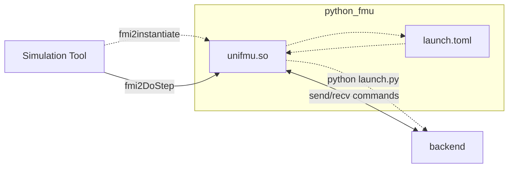
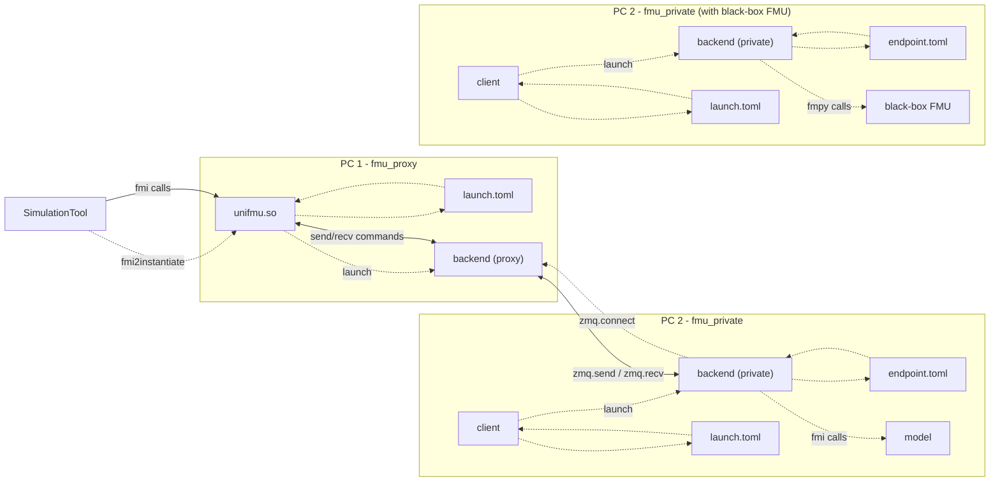

# UniFMU - Universal Functional Mock-Up Units

Create [Functional Mock-up Units (FMUs)](https://fmi-standard.org/) with models
written in Python, C#, or Java. UniFMU supplies the native FMI interface and
connects it to your model, so you do not need to implement the C interface yourself.

UniFMU supports **FMI2 and FMI3 Co-Simulation**. Model Exchange and Scheduled
Execution are not supported. See the [FMI function reference](docs/fmi-support.md)
for individual capabilities.

- [Install](#install)
- [Create your first FMU](#create-your-first-fmu)
- [Edit and pack a Python FMI2 model](#edit-and-pack-a-python-fmi2-model)
- [Use other languages or FMI3](#use-other-languages-or-fmi3)
- [Run a distributed model](#run-a-distributed-model)
- [Configure the runtime](#configure-the-runtime)
- [How it works](#how-it-works)
- [Help and further reading](#help-and-further-reading)
- [Citing UniFMU](#citing-unifmu)

Building UniFMU itself, testing changes, and publishing releases are covered in
the [development guide](development/README.md).

## Install

Download and extract the archive for your operating system and CPU from
[GitHub Releases](https://github.com/INTO-CPS-Association/unifmu/releases).
The CLI is a single executable that embeds the native libraries and model templates.
Add it to your `PATH`, or invoke it with `./unifmu` (`.\unifmu.exe` in PowerShell).

Generated FMUs identify the generator version in `modelDescription.xml`, for
example `generationTool="unifmu-0.14.0"`. This applies to local FMUs and distributed
proxies for FMI2 and FMI3. The Python annotation helper retains this version when
regenerating the XML; repacking an existing XML file preserves its metadata.

```bash
unifmu --version
unifmu --help
```

Install the runtime for your chosen model language separately. For the Python
workflow below, use **Python 3.10 or newer**, preferably in an activated virtual
environment. On Windows, replace `python3` with `python` if appropriate.

Release builds provide CLI archives for Linux x86-64/ARM64, macOS Intel/Apple
Silicon, and Windows x86-64. The CLI's architecture is independent of the model
languages and native libraries it can package.

## Create your first FMU

Generate an editable, uncompressed Python FMI2 project:

```bash
unifmu generate python my_model fmi2
python3 -m pip install -r my_model/resources/requirements.txt
```

The generated project is a working example model, ready to customize:

```text
my_model/
  binaries/                 Native FMI libraries for the included platforms
  resources/
    main.py                 Run the backend, generate XML, or pack the FMU
    model.py                Your model's variables and behavior
    fmi2_model_description.py
    backend.py              Dispatch FMI calls to your model
    abstract_backend.py
    launch.toml             Platform-specific runtime commands
    requirements.txt        Python runtime dependencies
    schemas/                Generated messaging bindings
    compilation_resources/  Optional PyInstaller scripts
    README.md               Python backend instructions
  modelDescription.xml      FMI interface and capabilities
```

Keep this directory as your source project. Edit `resources/model.py`, then
regenerate its description and create an archive as described below.
Do not rerun `unifmu generate` over your customized project.

To try a generated template directly as an archive instead:

```bash
unifmu generate python example.fmu fmi2 --zipped
```

An `.fmu` is a ZIP archive with `modelDescription.xml`, `binaries/`, and
`resources/` at its root.

## Edit and pack a Python FMI2 model

The local Python FMI2 template declares its interface using `typing.Annotated`
and `ScalarVariable` metadata. For example, inside the generated `Model` class:

```python
a: Annotated[float, ScalarVariable(
    causality=Causality.INPUT,
    variability=Variability.CONTINUOUS,
    variable_type=RealType(start=0.0),
)]
b: Annotated[float, ScalarVariable(
    causality=Causality.OUTPUT,
    variability=Variability.CONTINUOUS,
    initial=Initial.CALCULATED,
    variable_type=RealType(),
    dependencies=["a"],
)]
```

Use the imports already provided by the template, initialize the attributes, and
adapt its model calculations, reset, and state handling to your variables.
Annotations describe the interface; they do not implement model behavior.
Keep `build_reference_to_attribute_map(self)` so the runtime mapping and XML
use the same value references. Set the author with `@fmi_model("Your Name")`.
The [Python backend guide](assets/python/README.md#annotation-based-fmi2-models)
has a fuller example.

After editing, run these **two separate commands** from the directory containing
`my_model/`:

```bash
python3 my_model/resources/main.py --model-description
python3 my_model/resources/main.py --pack --output my_model.fmu
```

The first overwrites `my_model/modelDescription.xml` from the annotations.
The second creates `my_model.fmu` in your current directory.
Without `--output`, the archive is written to `my_model/my_model.fmu`.

**Regenerate the XML after changing variable declarations.** Packing preserves
an existing `modelDescription.xml`; it generates XML only if the file is absent.
Passing both flags in one invocation only generates the description.
Regeneration replaces any manual XML edits.

You can now repeat **edit, generate description, pack** without running UniFMU
again. Packing reuses the native binaries and includes the resources; it does not
rebuild libraries, compile Python, or bundle your Python environment. Keep
`resources/` free of unwanted cache/build files before packing.

This annotation-based description workflow is for **local Python FMI2 projects**,
not FMI3 or distributed projects.

### Try the resulting FMU

Import `my_model.fmu` into an FMI Co-Simulation tool, or install
[FMPy](https://github.com/CATIA-Systems/FMPy) to simulate it:

```bash
python3 -m pip install "fmpy[complete]"
fmpy simulate my_model.fmu --show-plot
```

The simulator must be able to launch the runtime configured in `launch.toml`,
with your model's Python dependencies installed.

## Use other languages or FMI3

The general syntax is:

```text
unifmu generate <language> <output> [fmi2|fmi3] [--zipped]
```

`fmi2` is the default. Supported language names are `python`, `c-sharp`, and
`java`. For example:

```bash
unifmu generate python my_fmi3_model fmi3
unifmu generate c-sharp my_csharp_model fmi2
unifmu generate java my_java_model fmi2
```

Follow the language-specific guide to change the model and its XML interface:

| Backend | Model and runtime documentation |
| --- | --- |
| Python | [Python guide](assets/python/README.md), including optional PyInstaller compilation |
| C# | [C# guide](assets/csharp/README.md) |
| Java | [Java guide](assets/java/README.md) |

These guides are also included in generated projects. The old
[MATLAB documentation](assets/matlab/README.md) is retained for reference;
MATLAB is not a supported CLI backend.

### Platform compatibility

In release builds, FMI2 macOS FMUs use one universal Intel/ARM64 dylib under
`binaries/darwin64`. FMI3 uses separate `x86_64-darwin` and `aarch64-darwin`
directories. macOS libraries target macOS 11 or newer.

FMI2 Linux uses `linux64` for x86-64 and `aarch64-linux` for ARM64; ARM64 importers
must understand that directory name. Linux release builds use Ubuntu 24.04's
glibc baseline, so compatibility with older Linux systems is not guaranteed.
See the [build guide](development/README.md#cross-platform-release-build)
for details.

## Run a distributed model

A distributed model separates the FMU imported by the simulator from the private
model process, which can run on another computer:

```bash
unifmu generate-distributed python remote_model fmi2 --endpoint 192.0.2.10
```

Replace `192.0.2.10` with the address of the computer running the **proxy FMU**.
The command creates:

| Directory | Purpose |
| --- | --- |
| `remote_model_proxy/` | FMU imported into the simulator; includes native libraries and proxy resources |
| `remote_model_private/` | Model and backend run separately; this directory is not an FMU |

Customize the private model and keep the proxy's `modelDescription.xml` consistent
with its interface. Install the private backend's runtime dependencies.
Start the proxy FMU in your simulator with UniFMU message logging enabled; it logs
the port to connect to. On the private model's computer, run:

```bash
python3 remote_model_private/main.py PORT_NUMBER
```

Replace `PORT_NUMBER` with the logged port, or omit it to enter it interactively.
The private backend reads the proxy address from `endpoint.toml`.
Ensure the proxy's port is reachable between the two computers.
Use `--zipped` when generating if you want the proxy as an `.fmu` archive.

For all options, including the FMI version:

```bash
unifmu generate-distributed --help
```

### Wrap an existing FMU

Add `--black-box-fmu` to use an existing FMU as the private model:

```bash
unifmu generate-distributed python remote_model fmi2 --black-box-fmu --endpoint 192.0.2.10
```

Place the existing FMU at `remote_model_private/remote_model.fmu`; its name must
match the output name without `_private`. This private backend uses Python and
FMPy regardless of the selected language. Configure the proxy XML to match the
wrapped FMU's interface.

Launch the black-box backend from its private directory so it can locate the FMU:

```bash
cd remote_model_private
python3 main.py PORT_NUMBER
```

## Configure the runtime

The generated `resources/launch.toml` selects a command for each platform:

```toml
linux = ["python3", "main.py"]
macos = ["python3", "main.py"]
windows = ["python", "main.py"]
```

Your simulation environment must provide that interpreter and the dependencies
used by your model. The same applies to Java and .NET models. Activating a Python
virtual environment before starting the simulator, or configuring the path to its
interpreter in `launch.toml`, can help select the right environment.

Commands are run **without a shell**. Environment-variable expansion, wildcards,
and shell syntax are not evaluated. To use a shell, invoke it explicitly:

```toml
linux = ["/bin/sh", "launch.sh"]
macos = ["/bin/sh", "launch.sh"]
windows = ["powershell.exe", "-File", "launch.ps1"]
```

For example, `resources/launch.sh` could contain:

```sh
#!/bin/sh
export FOO=BAR
exec python3 main.py "$@"
```

### Make an FMU portable

Packing an FMU does not install its runtime on another machine. You can bundle
an interpreter and dependencies in `resources/` and point `launch.toml` at it, or
use the [Python compilation scripts](assets/python/README.md#compilation).
Compiled backends and bundled interpreters must match the target platform.

### Declare model capabilities

An FMU need not implement every FMI function. Declare only capabilities that
your model actually supports in `modelDescription.xml`. For example, enabling
state serialization requires corresponding state save/restore methods in the
model, not just flags in the XML. See the backend guides and
[supported function reference](docs/fmi-support.md).

## How it works

### Local FMU

The native library receives FMI calls and starts the backend using `launch.toml`.
Calls and results are exchanged with the backend over ZeroMQ.



### Distributed FMU

The simulator starts a proxy FMU. The separately launched private backend
connects to the proxy's address and port and executes model calls.



## Help and further reading

- [Examples](https://github.com/INTO-CPS-Association/unifmu_examples)
- [Python model guide](assets/python/README.md)
- [FMI function support](docs/fmi-support.md)
- [Development, testing, and releases](development/README.md)
- [Issue tracker](https://github.com/INTO-CPS-Association/unifmu/issues)
- [Claudio Gomes](https://clagms.github.io/contact/) for maintenance inquiries

Use `unifmu generate --help` and `unifmu generate-distributed --help` for the
complete CLI options.

## Citing UniFMU

Legaard, C. M., Tola, D., Schranz, T., Macedo, H. D., & Larsen, P. G. (2021).
A Universal Mechanism for Implementing Functional Mock-up Units. In
*Proceedings of SIMULTECH 2021* (pp. 121-129). SCITEPRESS Digital Library.
https://doi.org/10.5220/0010577601210129

```bibtex
@inproceedings{Legaard2021,
  title = {A Universal Mechanism for Implementing Functional Mock-up Units},
  booktitle = {11th International Conference on Simulation and Modeling Methodologies, Technologies and Applications},
  author = {Legaard, Christian M. and Tola, Daniella and Schranz, Thomas and Macedo, Hugo Daniel and Larsen, Peter Gorm},
  year = {2021},
  pages = {121--129},
  address = {Virtual Event},
  series = {SIMULTECH 2021}
}
```
